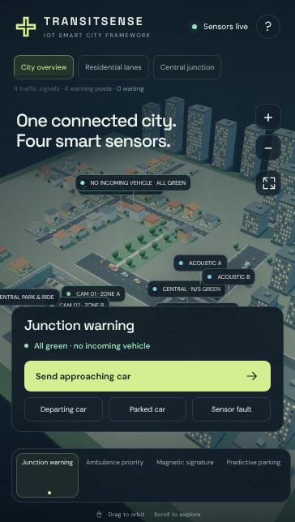

# Crosslight — 3D Smart City Simulation



An interactive Three.js concept showcase of smart-traffic features at a residential crossing and a busy urban junction.

- **Blind-junction warning:** approach posts turn red for cross traffic, with a sensor-fault fail-safe.
- **Ambulance priority:** signals clear the junction and hold green for an ambulance.
- **Magnetic signature:** vehicle classes detected by embedded sensors, with example waveforms.
- **Predictive parking:** projected free spaces at your arrival time across three zones.

## Run

- **Quick:** open `Crosslight.html` (single self-contained file) in a current browser.
- **From source:** `python3 -m http.server 4173 --directory dist`, then open http://localhost:4173.

## Checks

```sh
node check.mjs
node traffic-check.mjs
```

No package installation or build step is required. See [START-HERE.txt](START-HERE.txt) for controls and scope notes.
This is a concept demo and is not validated for real-road or emergency-control use.
